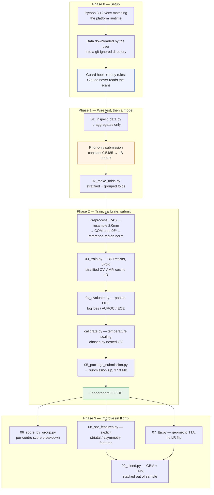
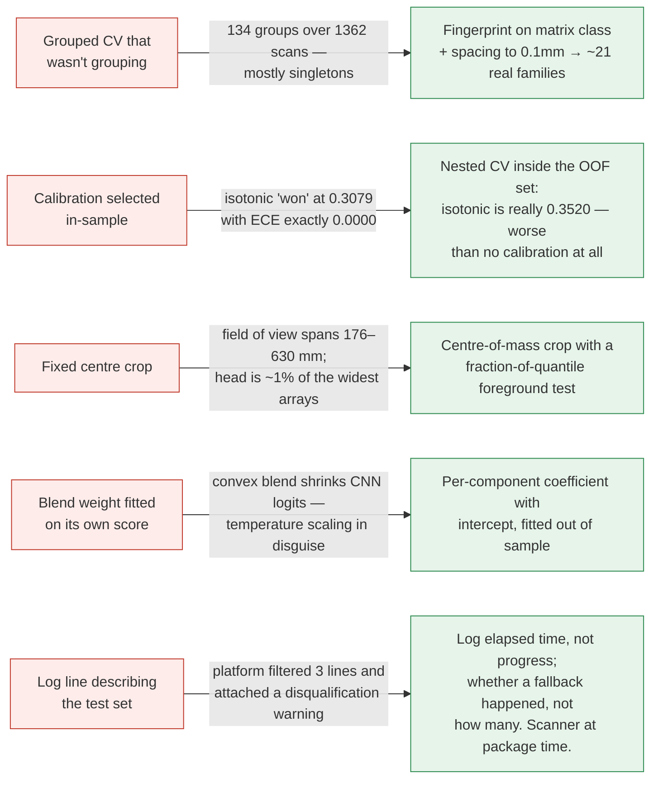
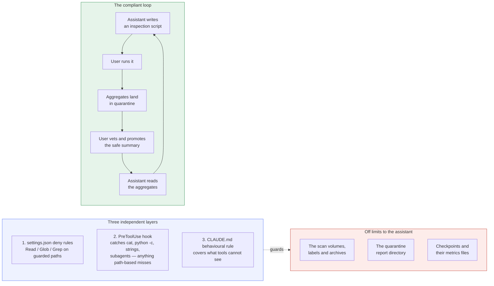

# 06 — Portfolio write-up notes

Raw material for the public write-up (GitHub README + portfolio site). Not the write-up itself —
this is the collected record so the final version can be assembled without re-deriving anything.

Sources of truth, all in-repo: [`reports/experiments/log.md`](../../reports/experiments/log.md)
(every run and every negative result), [`conf/baseline.yaml`](../../conf/baseline.yaml) (the
settings below), [`docs/03_plan.md`](../03_plan.md) (the phase plan as written on day 1).

---

## 1. The pitch

> A binary classifier for DaT SPECT brain scans — normal vs. abnormal dopamine transporter
> uptake — built for the French Society of Nuclear Medicine's DrivenData challenge. 1,362 3D
> NIfTI volumes from ten French hospitals, with **variable shape and variable voxel spacing**.
> Scored on **log loss**, so calibration counts as much as discrimination. Submission is
> code-execution: a zip that runs on the platform with no network access.
>
> A 3D ResNet baseline reached **0.3186 OOF log loss / 0.9302 AUROC**, and scored **0.3210 on
> the leaderboard** — a CV↔LB gap of **0.0024**, which is the number the rest of the project
> is built on.

The thing worth leading with is not the score. It is that the score was *predictable* — and the
several ways the project nearly fooled itself before it got there.

---

## 2. What we did, end to end

**Two structural choices worth explaining in the write-up:**

**The prior-only submission came first.** Before any model existed, a zip that predicts one
constant for every row went to the platform. It carries no model, so nothing about it can fail
for a *modelling* reason — whatever breaks is the platform contract: a path, an import, the
output location, the zip layout. It scored 0.6687, which is meaningless as a score and was
never meant to be one. It was a wire test, and it meant that when the real model went up the
next day, a bad score could only mean the model.

**Preprocessing is scale-invariant by construction.** Shape and spacing both vary across the ten
centres, so every step resamples to physical millimetres rather than trusting array indices.

---

## 3. The baseline setting (run 1 — the 0.3186 / 0.9302 result)

`conf/baseline.yaml`, recorded as row 1 of the experiment log, 2026-09-08.

| group | setting | value |
|---|---|---|
| **Preprocess** | target spacing | 2.0 mm isotropic |
| | target shape | 96 × 96 × 96 |
| | crop | `com` — centre of mass, **not** geometric centre |
| | normalization | `reference_region` |
| | orientation | `as_closest_canonical` (RAS) |
| **Model** | architecture | `resnet3d`, GroupNorm |
| | widths | 16 / 32 / 64 / 128 |
| | dropout | 0.3 |
| **Train** | epochs | 30, early stop patience 8 |
| | batch size | 8 |
| | optimiser | AdamW, lr 3e-4, weight decay 1e-4 |
| | schedule | cosine, 2 warmup epochs |
| | precision | AMP, grad clip 1.0 |
| | seed | 42 |
| **CV** | scheme | 5-fold **stratified** (`fold_strat`) |
| **Augment** | geometric | rotate ±10°, translate 5 mm, scale 0.9–1.1 |
| | intensity | jitter 0.1, noise σ 0.01 |
| | `flip_lr` | **false** — see §5.4 |
| | mixup | off |
| **Calibrate** | method | temperature scaling, **T = 1.2614** |
| | clip | 1e-06 |
| **Inference** | ensemble | 5 fold checkpoints averaged **in logit space** |
| | fallback | 0.5485 (the training positive rate) |

### Results

| quantity | value |
|---|---|
| OOF log loss, calibrated | **0.3186** |
| OOF log loss, uncalibrated | 0.3271 |
| OOF AUROC | **0.9302** |
| ECE | 0.0220 |
| Leaderboard (full test set) | **0.3210** |
| **CV ↔ LB gap** | **+0.0024** (< 1% relative) |
| Prior-only floor (constant 0.5485) | 0.6884 |
| Improvement over the floor | 0.3698 |

Training set: n = 1362, 747 positive / 615 negative (54.85% positive).

---

## 4. Why the 0.0024 gap is the headline

A 0.0024 CV↔LB gap closed three questions at once, and the write-up should say so explicitly
because it is the moment the project stopped guessing:

1. **Is CV trustworthy?** Yes, to within 0.0024. Every later decision can be made on OOF log
   loss without spending a submission slot.
2. **Is there prior shift between train and test?** No. An earlier smoke-test score had implied
   a test positive rate near 0.65 against a training rate of 0.5485 — a shift that size would
   have cost far more than 0.0024. That smoke score was computed on fake data, so it said nothing about the test set, and the temptation to "correct" for it was correctly resisted. Fitting a
   constant to leaderboard feedback is probing, not modelling.
3. **Is grouped CV worth the compute?** Probably not, and this *reversed* an earlier
   recommendation. Grouped CV exists as a proxy for "will the leaderboard track my CV". The
   leaderboard answered that directly. Grouped CV remains the right measurement for a different
   question — "would this generalise to an eleventh hospital" — which is a real question about
   the solution's worth, just not the one being scored.

---

## 5. The interesting failures

These are the write-up. A score is a number; these are the reasons to trust it.

### 5.1 Calibration was being selected in-sample

The single best story in the project. `choose_calibrator` fitted each candidate on the OOF
predictions and scored it **on those same predictions**. Temperature scaling has one parameter
and barely benefits. Isotonic regression has of order *n* knots and can drive in-sample log loss
almost arbitrarily low — so it won every comparison by construction.

| method | in-sample (wrong) | cross-validated (honest) |
|---|---:|---:|
| isotonic | 0.3079 | **0.3520** |
| temperature | 0.3186 | **0.3217** |
| none | 0.3271 | 0.3271 |

**Isotonic was worse than applying no calibration at all**, and shipping it would have cost real
leaderboard points while the report claimed a gain. The tell was an ECE of exactly 0.0000 — not
a well-calibrated model, a curve memorising its own training data.

A second bug rode along with it: the evaluator emitted `--temperature 1.0000` whenever the
winning calibrator had no `.temperature` attribute, so *following its own printed instructions*
would have shipped an uncalibrated model.

The general lesson, which then shaped every later comparison including the blend: **the more
flexible method wins any comparison scored on its own training data.**

### 5.2 Grouped CV that wasn't grouping

The original acquisition fingerprint used full shape plus full-precision spacing. That produced
134 groups over 1362 scans, most of them singletons, because slice count and reconstruction zoom
vary *per patient* rather than per scanner. Grouped CV was doing nothing while appearing to be
applied — the most dangerous kind of bug, because the output looks right.

Fixing it to in-plane matrix class plus spacing rounded to 0.1 mm collapsed those into ~21 real
acquisition families. The largest is ~34% of the data, so grouped folds are deliberately uneven
(115 to 460 scans, positive rate 46.3% to 59.3%) — that is correct, not a bug, and it means
per-fold grouped scores are not comparable to each other. Only pooled OOF means anything.

It also means **grouped log loss is penalised twice and only one penalty is a model defect**:
with validation priors from 46.3% to 59.3%, each fold has a train/val prior mismatch, so the
model mis-predicts systematically before discrimination is even considered. AUROC is invariant
to that. Read grouped AUROC and grouped log loss separately.

### 5.3 Submission logs must not describe the test set

Run 1's submission came back with a compliance warning: three log lines replaced by
`WARNING: line filtered`, and a note that non-compliance may result in disqualification.

The filtered lines were exactly the three containing `len(submission)`. A line reporting
`Loaded 5 fold models on cuda` survived — so numbers as such are fine; **the test set's row
count is not**, in any form: a total, a progress denominator, a row index, or a failure count.

Two things worth keeping in the write-up. The warning is *content-based*, so "log less" is the
wrong lesson — the right one is "log nothing derived from the test data". And it was only
diagnosable because the surviving line acted as a control; had every line been filtered there
would have been nothing to reason from. `main.py` now reports elapsed time instead of progress,
and the packaging script scans logger calls at package time, pinned by a test.

### 5.4 Domain knowledge that changed a hyperparameter

`flip_lr: false` is the example to use. Left-right flip is the most obvious augmentation for a
brain volume and almost every 3D imaging recipe includes it. Here, DaT abnormality is frequently
asymmetric and the more-affected side carries clinical meaning — so mirroring a scan averages
away a diagnostic signal. It is still logged as an open question to *test* rather than assumed,
but the prior comes from the domain, not from the default recipe. The same reasoning removes
the LR flip from the TTA views in `07_tta.py`.

---

## 6. The compliance architecture (distinctive — lead with this if the audience is engineers)

The competition rules prohibit exposing the competition data to third-party AI services. This
repo was built with an AI coding assistant, so the constraint had to be *enforced*, not merely
intended.

The rule that makes it work: **an aggregate is a number computed over many samples.**
`n=1247, 38% positive` is aggregate. A single scan id with its label and mean intensity is a
data row, and stays out — even from the vetted directory.

The honest framing for a portfolio: this is what it looks like to use an AI assistant on data it
is contractually not allowed to see. The assistant writes the code and reads the metrics; it
never sees a voxel. Worth noting the workflow cost something — every "what does the data look
like" question becomes a script — and bought something back: the EDA is reproducible, because it
had to be a committed script rather than a notebook cell someone ran once.

The hook is defence in depth on purpose. A path-based deny rule alone does not stop `cat`,
`python -c`, `strings`, or a subagent asked to look; the hook inspects the command. And the
default for any tool it does not recognise is **block**, because the rule is about data reaching
a model's context, not about which tool was used.

---

## 7. Loose ends to resolve before publishing

- [ ] **Final score and rank** — fill in after the 2026-09-16 deadline.
- [ ] Phase 3 outcomes: TTA, SBR features, CNN+GBM blend — each either a row in the experiment
      log or a documented negative result. Negative results stay in; they are the point.
- [ ] Grouped-CV numbers if compute ever becomes cheap (the "eleventh hospital" question).
- [ ] Open questions still unanswered in the log: does `flip_lr` help, and what is the optimal
      prediction clip on OOF.
- [ ] Decide how much of the plan-vs-actual to show. The plan was 11 days against a deadline
      moved in by 4; Phase 3 absorbed the whole compression. That is an honest and unusual thing
      to publish.
- [ ] Confirm what may be public. Code is MIT (a winner obligation anyway); **no data, no
      derived checkpoints, no per-sample values** in any figure or table.
- [ ] Figures: an OOF reliability diagram and the calibration comparison table are the two
      visuals that carry the most argument. Both are aggregate, so both are safe to publish.
